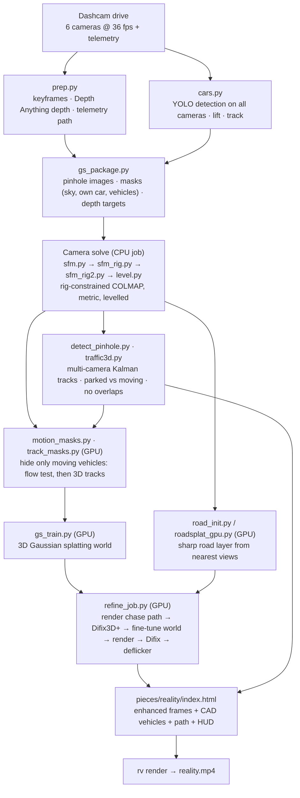

# Tesla Reality View, rebuilt from dashcam footage

A recreation of Tesla FSD v15 "Reality View" (a third-person view of the car, generated from its own cameras), built
from a public six-camera Tesla dashcam drive: camera calibration and structure from motion, a 3D Gaussian-splat world,
a sharp road layer, diffusion clean-up (Difix3D+), tracked traffic drawn as CAD vehicles, and a Tesla-style HUD.

- **Data:** [cfahlgren1/tesla-fsd-drive-5min](https://huggingface.co/datasets/cfahlgren1/tesla-fsd-drive-5min) (CC BY 4.0): six cameras at 36 fps and per-frame telemetry.
- **The piece:** `pieces/reality/index.html`, rendered by the code-driven motion harness in this repo (`bin/rv.mjs`).
- **The pipeline:** `pieces/reality/prep/` (see its README) and the GPU job scripts in `pieces/reality/prep/jobs/`.
- **Status and next steps:** **[HANDOFF.md](HANDOFF.md)**, start there.

## Pipeline



```bash
npm install                                   # three.js for the piece
node bin/rv.mjs help                       # harness commands
node bin/rv.mjs render reality             # needs the prepared data in out/reality-data (see HANDOFF.md)
pieces/reality/prep/jobs/local_clip_cpu.sh clip_04 270 && pieces/reality/prep/jobs/local_clip_gpu.sh clip_04 270   # any clip, one GPU
```

The harness itself (deterministic frame rendering, motion blur, review tools) is documented in `docs/`
(`docs/workflow.md` first).
